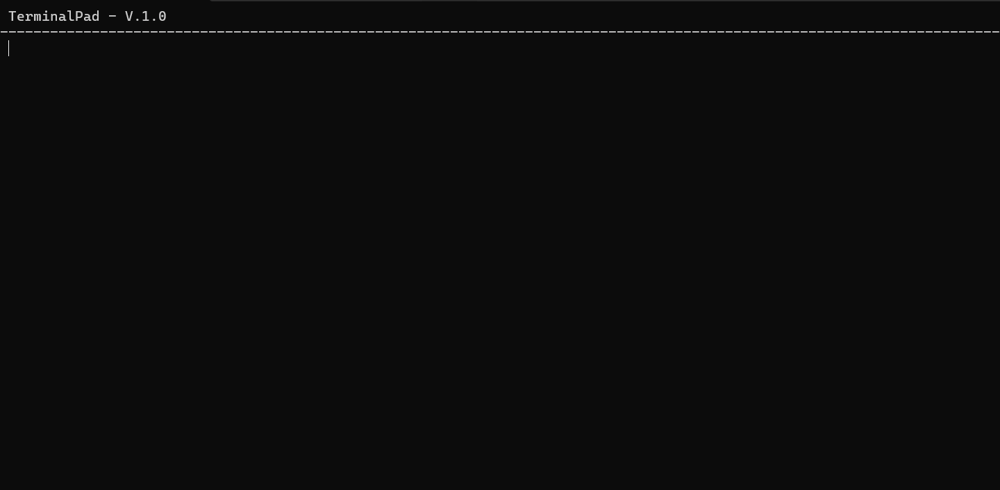
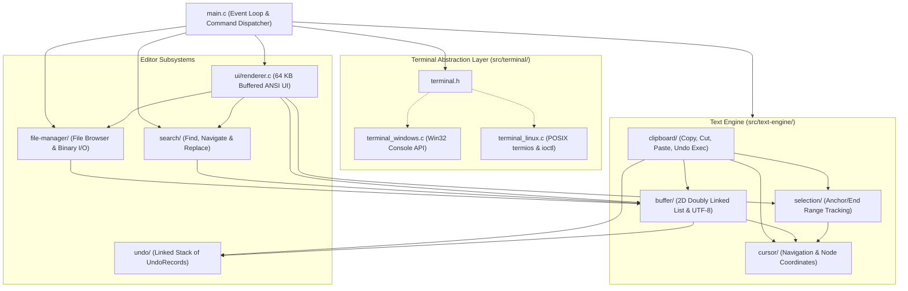
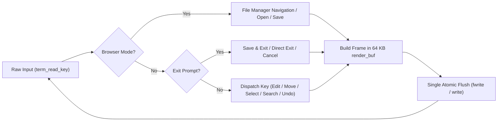

# TerminalPad

A lightweight, cross-platform terminal text editor built from scratch in **pure C11** with **zero external dependencies** (no `ncurses`, no third-party libraries).

TerminalPad implements its own 2D doubly linked list text engine, native UTF-8 character handling, flicker-free buffered ANSI renderer, stack-based undo system, built-in file browser, and OS-level raw keyboard & clipboard integration on both **Windows** and **Linux**.

---

## Demo



*Showcasing native UTF-8 (Turkish) typing, multi-line selection, block deletion, atomic undo (`Ctrl+Z`), and built-in file saving/loading.*

---

## Highlights

- **Zero External Dependencies:** Built strictly on standard C11, the Win32 Console/Clipboard API (`windows.h`), and POSIX `termios`/`ioctl` on Linux.
- **Native UTF-8 / Multi-Byte Support:** Full Turkish and Unicode character editing, cursor navigation, selection, search/replace, and file I/O with 1 node = 1 visual character.
- **Flicker-Free Rendering:** 64 KB static frame buffer with in-place ANSI line overwriting (`\033[H` + `\033[2K`) and single atomic `fwrite`/`write` flush per frame.
- **Rich Editing Features:** Multi-line text selection, OS clipboard sync (Windows), block/word navigation & deletion, case-insensitive find, match navigation, non-overlapping find & replace, and atomic undo.
- **Built-In File Explorer:** Directory browsing with folder-first alphabetical sorting (`qsort`), open/save/save-as workflows, and full-path tracking across directory changes.

---

## System Architecture

TerminalPad is organized into cleanly separated modules where `main.c` acts as the event dispatcher between the platform terminal layer, the text engine, and the buffered UI renderer.



---

## Core Data Structure: 2D Doubly Linked List

Instead of flattening the document into a single byte array, TerminalPad represents text as a **doubly linked list of lines (`line_x`)**, where each line owns a **doubly linked list of character nodes (`node_x`)** anchored by a sentinel `dummynode`.

```text
headline
  |
  v
+----------+     +-----------+     +---------+     +---------+     +---------+
|  line_x  |---->| dummynode |<--->|  "H"    |<--->|  "i"    |<--->|  "!"    |--> NULL
+----------+     +-----------+     +---------+     +---------+     +---------+
   |   ^
   v   |
+----------+     +-----------+     +---------+     +---------+     +---------+
|  line_x  |---->| dummynode |<--->|  "a"    |<--->|  "ş"    |<--->|  "k"    |--> NULL
+----------+     +-----------+     +---------+     +---------+     +---------+
   |                                                   ^
   v                                                cursor
  NULL
```

- **Sentinel `dummynode`:** Every line starts with an empty `dummynode` (`""`). Placing `cursor` on `dummynode` cleanly represents column `0` (before the first character) without special-casing empty lines or head-pointer updates.
- **Cursor Invariant:** `cursor` always points to the node immediately **to the left** of the insertion point. Inserting a character, deleting a character, or splitting a line at `cursor` are all **$O(1)$** pointer rewirings.

---

## Event & Render Pipeline

Every keypress runs through a deterministic, single-threaded input-mutate-render loop:



---

## Architectural Decisions & Trade-Offs

### 1. Node-Level UTF-8 with Zero Extra Memory Overhead (`char letter[5]`)
Storing a single `char` per node breaks multi-byte UTF-8 characters (e.g., Turkish `ş` = `0xC5 0x9F`, emojis = 4 bytes) across multiple nodes, forcing every cursor, deletion, undo, and rendering loop to check continuation bytes.

Instead, each `node_x` stores a null-terminated UTF-8 character (`char letter[5]` — up to 4 UTF-8 bytes + `'\0'`):

```c
typedef struct node{
    char letter[5];
    struct node *prev;
    struct node *next;
} node_x;
```

**Why this costs 0 extra RAM on 64-bit systems:**  
Because `prev` and `next` pointers require 8-byte alignment, the compiler already pads a 1-byte `char` with 7 unused bytes:

```text
char letter;     -> [ 1B data | 7B padding ] [ 8B prev ] [ 8B next ] = 24 bytes
char letter[5];  -> [ 5B data | 3B padding ] [ 8B prev ] [ 8B next ] = 24 bytes
```

By utilizing existing struct padding, **1 node always equals 1 visual character** at zero additional memory cost. UTF-8 byte-length decoding (`utf8_char_len`) is isolated strictly to I/O boundaries (keyboard input, file loading, clipboard paste, and search).

### 2. Flicker-Free Single-Flush Renderer & $O(1)$ Highlighting
Early terminal editors often clear the entire screen (`cls` / `\033[2J`) and print characters one by one via `printf()`, causing severe flickering during rapid typing or key-repeat deletion.

TerminalPad eliminates flicker with three techniques in [renderer.c](src/ui/renderer.c):
1. **Viewport-Only Static Buffer (`render_buf[65536]`):** The entire visible frame (header, visible text lines, ANSI highlight codes, optional prompt, cursor positioning) is assembled in RAM and flushed in **one atomic `fwrite`/`write` call**. Because only the visible viewport is buffered, `render_buf` stays fixed at **64 KB** regardless of whether the file has 10 lines or 1,000,000 lines.
2. **In-Place Line Overwrite (`\033[H` + `\033[2K`):** Instead of blanking the screen to black, the cursor resets to `(1,1)` and overwrites each line in place while hiding the cursor (`\033[?25l` ... `\033[?25h`) within the same flush.
3. **$O(1)$ Per-Character Highlighting:** Selection bounds are normalized **once per frame** and tracked via a streaming state flag while walking visible nodes. Similarly, sorted search matches advance a single pointer in amortized **$O(1)$** per character rather than rescanning the match list for every cell.

### 3. Linked List vs. Gap Buffer / Piece Table (Honest Trade-Off)
| Data Structure | Memory (1 MB file) | Mid-Text Insert/Delete | Implementation Complexity |
| :--- | :---: | :---: | :---: |
| **2D Doubly Linked List** *(TerminalPad)* | ~32 MB | $O(1)$ | Low, transparent pointer model |
| **Gap Buffer** *(e.g. Emacs)* | ~1 MB | $O(1)$ near cursor | Medium |
| **Piece Table** *(e.g. VS Code)* | ~1 MB | $O(1)$–$O(\log P)$ | High |

A 2D doubly linked list was chosen for clean $O(1)$ edits, straightforward line splitting/merging, and readable pointer mechanics. Scaling to multi-hundred-megabyte log files would be the natural point to migrate the underlying buffer to a **Gap Buffer** or **Piece Table**.

### 4. Raw Terminal Input & Cross-Platform Separation
- **Windows ([terminal_windows.c](src/terminal/terminal_windows.c)):** Uses `ReadConsoleInputW` rather than `_getch()` so modifier combinations (`Ctrl+Shift+Arrow`, `Alt+Backspace`, `Ctrl+Backspace`) and UTF-16 Unicode keys are captured accurately, converting non-ASCII characters directly to UTF-8 via `WideCharToMultiByte`. Enables `ENABLE_VIRTUAL_TERMINAL_PROCESSING` for ANSI output and integrates with the native Win32 clipboard (`CF_UNICODETEXT`) in [clipboard.c](src/text-engine/clipboard/clipboard.c).
- **Linux ([terminal_linux.c](src/terminal/terminal_linux.c)):** Configures raw mode via `termios`, parses ANSI/xterm escape sequences with a 100 ms `VTIME` timeout to distinguish standalone `ESC` from escape sequences, and supports terminal Bracketed Paste (`\033[?2004h`) so pasted text is grouped into a single undo record.

### 5. Undo & File I/O Safeguards
- **Linear-Time File Loading ($O(N)$):** `fm_load_file()` temporarily disables undo recording (`undo_enabled=0`) and resets the undo stack, preventing $O(N^2)$ coordinate scans and ensuring `Ctrl+Z` never undoes freshly loaded file contents.
- **Full-Path Persistence:** Opening or saving a file resolves and stores its absolute path (`_getcwd`/`getcwd`), so browsing other directories with `Ctrl+O` and canceling with `ESC` never misdirects a subsequent `Ctrl+S`.
- **Non-Overlapping Replace:** `search_replace_all()` filters overlapping matches (e.g., replacing `"aa"` with `"b"` in `"aaaa"` yields `"bb"`) and applies edits back-to-front so earlier column indices remain valid.

---

## Keyboard Shortcuts

| Shortcut | Action |
| :--- | :--- |
| `Arrow Keys` | Move cursor |
| `Ctrl + Left / Right` | Jump by word / whitespace block |
| `Shift + Arrows` | Character / line selection |
| `Ctrl + Shift + Left / Right` | Word-level selection |
| `Backspace` / `Delete` | Delete character left / right (or merge lines) |
| `Ctrl + Backspace` / `Alt + Backspace` | Delete word / whitespace block left |
| `Tab` | Insert 4 spaces |
| `Ctrl + C` / `Ctrl + X` / `Ctrl + V` | Copy / Cut / Paste (synced with Windows clipboard) |
| `Ctrl + Z` | Undo (char, line, cut, paste) |
| `Ctrl + F` | Find (case-insensitive highlight + jump to first match) |
| `Ctrl + G` | Find & navigate between matches with arrow keys |
| `Ctrl + R` | Find & replace all |
| `Ctrl + O` | Open file browser |
| `Ctrl + S` / `Ctrl + W` | Save / Save As |
| `ESC` | Clear search / Cancel prompt / Exit confirmation (`Y/N`) |

---

## Project Structure

```text
TerminalPad/
├── CMakeLists.txt
├── makefile
├── public/
│   └── TerminalPad.webp              # Demo animation
└── src/
    ├── main.c                        # Entry point, event loop & shortcut dispatch
    ├── file-manager/
    │   ├── file_manager.h
    │   └── file_manager.c            # Directory listing (qsort), binary UTF-8 load/save, full-path tracking
    ├── search/
    │   ├── search.h
    │   └── search.c                  # Node-level UTF-8 search, match navigation & non-overlapping replace
    ├── terminal/
    │   ├── terminal.h                # Platform-independent key codes & terminal API
    │   ├── terminal_windows.c        # Win32 Console API raw mode & UTF-16 -> UTF-8 input
    │   └── terminal_linux.c          # POSIX termios raw mode, escape parser & bracketed paste
    ├── text-engine/
    │   ├── buffer/
    │   │   ├── buffer.h
    │   │   └── buffer.c              # 2D doubly linked list, UTF-8 nodes, insert/delete/merge/free
    │   ├── clipboard/
    │   │   ├── clipboard.h
    │   │   └── clipboard.c           # Copy, cut, paste, OS clipboard bridge & undo execution
    │   ├── cursor/
    │   │   ├── cursor.h
    │   │   └── cursor.c              # Cursor movement, block skipping & node coordinate lookup
    │   └── selection/
    │       ├── selection.h
    │       └── selection.c           # Anchor/end selection range management
    ├── ui/
    │   ├── renderer.h
    │   └── renderer.c                # 64 KB buffered flicker-free ANSI renderer & file browser UI
    └── undo/
        ├── undo_stack.h
        └── undo_stack.c              # ISO C11 linked stack for undo history
```

---

## Building & Running

### Windows (MinGW / MSYS2 GCC)
```powershell
# Using Makefile
mingw32-make
.\TerminalPad.exe

# Or directly with GCC
gcc -std=c11 -Wall -Wextra -D_WIN32 -I src src/main.c src/text-engine/buffer/buffer.c src/text-engine/clipboard/clipboard.c src/text-engine/cursor/cursor.c src/text-engine/selection/selection.c src/search/search.c src/ui/renderer.c src/file-manager/file_manager.c src/undo/undo_stack.c src/terminal/terminal_windows.c -o TerminalPad.exe -lkernel32 -luser32
.\TerminalPad.exe
```

> **Tip:** Run `TerminalPad.exe` in **Windows Terminal** or **PowerShell/CMD** rather than an IDE's embedded terminal so shortcuts like `Ctrl+F`, `Ctrl+S`, and `Ctrl+W` are forwarded directly to the editor.

### Linux / macOS
```bash
make
./TerminalPad
```

### CMake (Cross-Platform)
```bash
cmake -B build
cmake --build build
./build/TerminalPad        # Windows: .\build\TerminalPad.exe
```

---

## Collaboration Note

TerminalPad was originally developed as a two-person C systems programming project and later refactored for clean architecture, memory safety, native node-level UTF-8 support, and flicker-free rendering.
